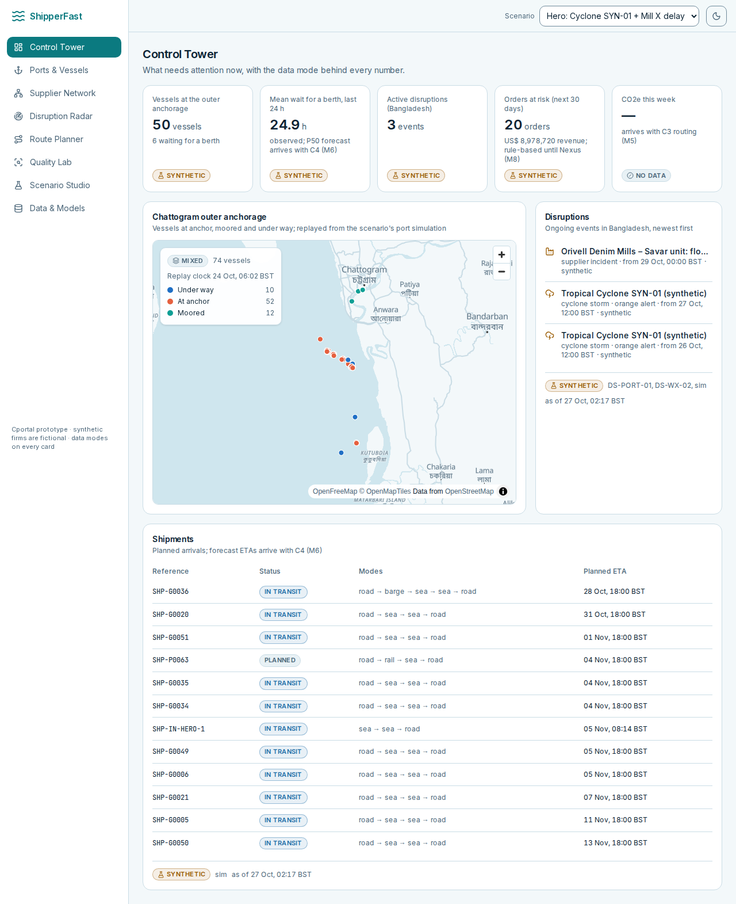

# ShipperFast (codename Cportal)

A supply-chain resilience platform proven on Bangladesh's Chattogram–Dhaka corridor for garment
and pharma shippers. The full specification is in [`docs/brief/`](docs/brief/00-INDEX.md); agents
start from [`AGENTS.md`](AGENTS.md), and progress lives in [`docs/STATUS.md`](docs/STATUS.md).

**Current milestone: M2 (Backbone), at gate G2.** One command brings up the database, API,
worker (live fetches, AIS replay, outbox jobs) and the web app with the Control Tower and the
Data & Models page. Capabilities C1–C5 start in M3.



> Synthetic data is never presented as real: every row carries `data_mode` and `is_synthetic`,
> every API response carries a `meta.mode` badge, and synthetic firms are fictional.

## Quickstart (Docker)

Requires Docker with Compose and GNU make; your user must be in the `docker` group.

```bash
make demo                  # build + start db, api, worker, web; seed both scenarios (~2 min)
```

Then open http://127.0.0.1:3000 (API docs at http://127.0.0.1:8000/docs). `make up` starts the
stack without re-seeding, `make down` stops it (data stays in the `pgdata` volume). Keys are
optional: `make up` creates `.env` from `.env.example` if it is missing, and sources without a
key stay in replay or synthetic mode. `CPORTAL_LIVE=0 make up` keeps the worker offline.

## Quickstart (laptop, no Docker)

Requires [uv](https://docs.astral.sh/uv/) (it fetches Python 3.12 itself), Node 20.9+ and GNU
make.

```bash
make setup                 # uv sync: workspace + dev tools
cp .env.example .env       # then fill in the keys you have (see the comments)
make db-local              # user-level Postgres 16 + PostGIS + pgvector (installs on first run)
make seed                  # migrate, replay real samples, seed the synthetic scenarios (~30 s)
make api                   # http://127.0.0.1:8000/docs
make worker                # in a second terminal: live fetches, AIS replay, jobs
make web-setup && make web # in a third: http://127.0.0.1:3000
```

`make db-local` and the compose `db` both use port 5432: run one at a time
(`make db-local-stop` / `make down`).

## What is in the box

| Area | Where | Notes |
|---|---|---|
| Domain model v1 (51 tables) | `packages/core` | ORM, canonical records, loader; [ERD](docs/ERD.md); migrations in `db/alembic` |
| Sources (48 probed) | `packages/connectors` | `uv run probe`, parsers per source, `uv run ingest --replay all` |
| Synthetic world + port DES | `packages/sim` | `uv run seed`, `uv run calibrate` → [CALIBRATION.md](docs/data-sources/CALIBRATION.md) |
| API | `apps/api` | `/api/v1`, `/ws/live`; OpenAPI in [docs/api/openapi.json](docs/api/openapi.json) |
| Worker | `apps/worker` | live fetches with two strikes, AIS replay, outbox and jobs |
| Web | `apps/web` | Next.js 16; Control Tower, Data & Models; types from the OpenAPI file (`npm run gen:api`) |
| Decisions | [docs/adr/](docs/adr/README.md), [DECISIONS.md](docs/DECISIONS.md) | ADR-001…015 |

Scenarios: `baseline` and `cyclone_supplier_delay` (the hero: a synthetic cyclone closes
Chattogram while "Fabric Mill X" floods). Select one with `?scenario=` on any API read; omit it
(`?scenario=`) for real data only.

## Probing data sources

```bash
uv run probe --list        # every DS-ID, its tier, status and whether its key is set
uv run probe DS-WX-01      # probe one source (make probe DS=DS-WX-01)
uv run probe --tier P0     # probe a whole tier, politely, one source after another
uv run probe --card DS-WX-01   # re-render the card's evidence block from the latest run
```

Each run keeps the request, the raw response and its metadata under
`data/raw/_probes/<DS-ID>/<UTC-ts>/` (gitignored), merges an inferred JSON Schema into
`schemas/raw/<DS-ID>.schema.json`, and copies small samples into `data/samples/<DS-ID>/`.
Source cards and the probe report are in [`docs/data-sources/`](docs/data-sources/).

## Checks

```bash
make check  # ruff, import boundaries, mypy, pytest (DB tests run when Postgres is up), tsc, ESLint
make e2e    # Playwright smoke against http://127.0.0.1:3000; screenshots → docs/screenshots
make calibrate  # port DES vs real marginals
make erd    # regenerate the ERD from the models
```

## Names and brand

`CPORTAL_BRAND_NAME` sets the product name. `CPORTAL_NAME_PACK=bd_demo` shows well-known
Bangladeshi company names on the hero manufacturers for the demo, with a banner; all figures stay
synthetic, and views of adverse synthetic attributes (defects, risk) keep the fictional names
([ADR-014](docs/adr/ADR-014-name-packs-and-the-brand-variable.md)).
