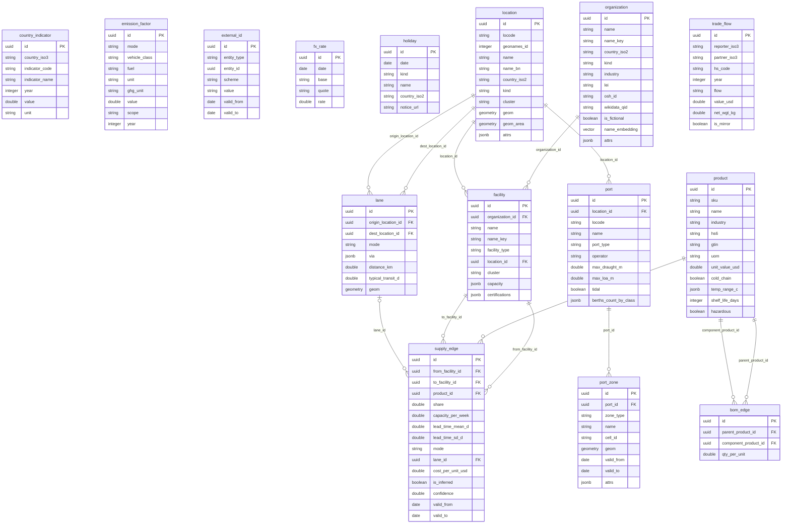
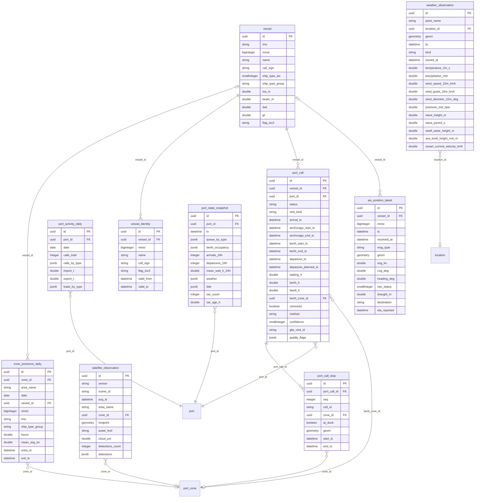
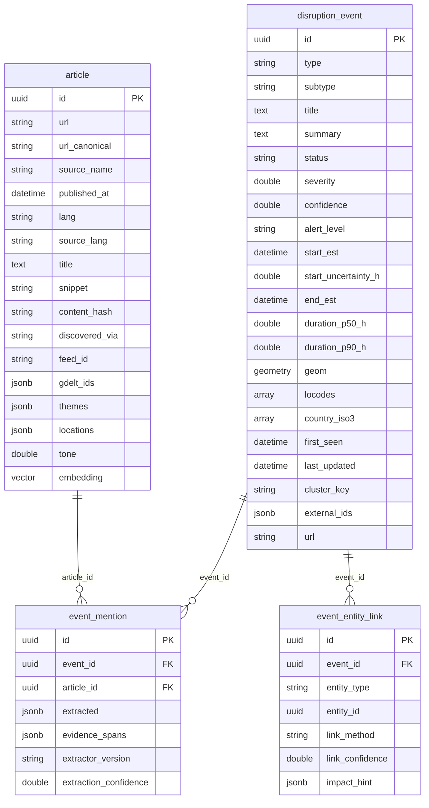
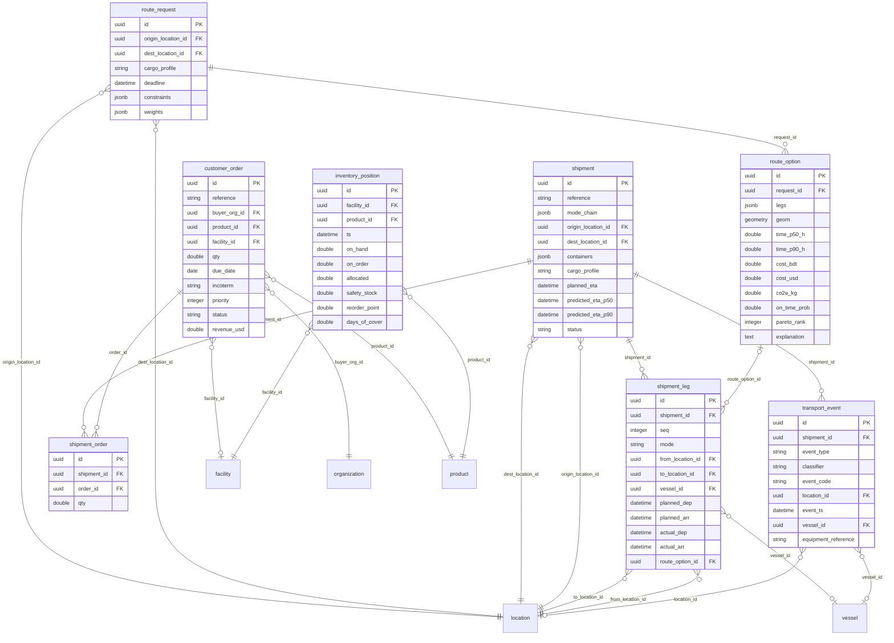
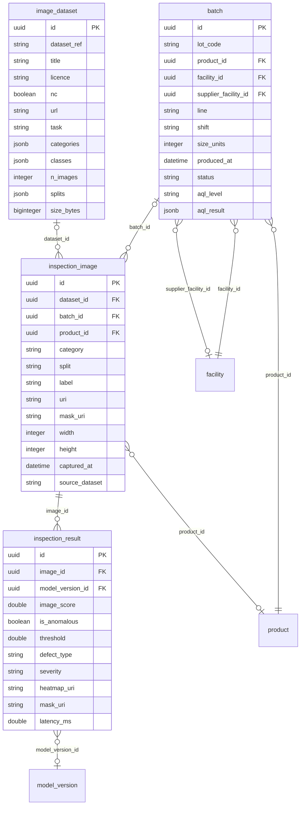
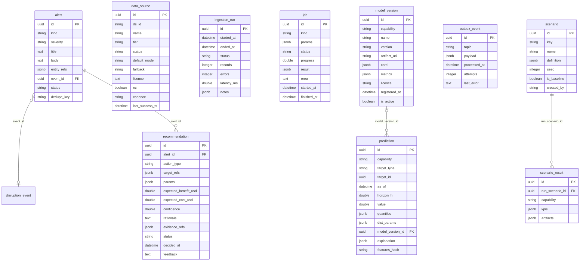

# Entity-relationship diagram (domain model v1)

_Generated from `packages/core/src/cportal_core/models/` (51 tables) by `make erd`. Edit the models, not this file._

Every domain table also carries the lineage columns (04 §4, SC-01): `source_id`, `source_record_id`, `data_mode`, `is_synthetic`, `scenario_id`, `generator_version`, `ingested_at`, `available_at`, `created_at`, `updated_at`. The database enforces `is_synthetic = (data_mode = 'synthetic')` and that synthetic rows carry a `scenario_id`. `outbox_event` and `job` are infrastructure without lineage.

## Reference and supply network

## Maritime and port

## News and disruption events

## Orders, shipments and routes

## Quality

## Platform: scenarios, alerts, models, sources, jobs

