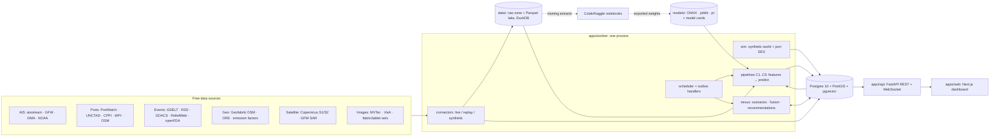

# 02 · Architecture

**TL;DR.** The system is a modular monolith: one Postgres (with PostGIS and pgvector), one FastAPI `api`, one `worker` built from the same Python codebase, and one Next.js `web`. Bulky history (AIS, raw API payloads) lives as Parquet files queried with DuckDB. Each capability is its own Python package with a typed contract, its own CLI and its own tests. Notebooks on Colab or Kaggle train models; the app only loads exported artifacts and runs CPU inference. Every connector runs in one of three modes: `live`, `replay` (recorded real responses) or `synthetic`, and all three produce the same canonical schema.

## 1. Principles

1. **One of each until proven otherwise:** one database, one API, one worker, one web app. A new service needs an ADR with a measured reason.
2. **Contracts before code.** Pydantic schemas define every capability's inputs and outputs. The OpenAPI spec generates TypeScript types.
3. **Same schema, three modes.** Real, replayed and synthetic data are interchangeable per source (D-08).
4. **Precompute what is heavy, serve what is light.** The worker does the batch work; the API reads results.
5. **Provenance everywhere.** Every row records source, mode, version and time.
6. **Honest ML.** Baseline first, intervals always, and a model card for every model.

## 2. System diagram



## 3. Runtime (docker-compose)

| Service | Image / command | Notes |
|---|---|---|
| `db` | Small custom image: `FROM postgis/postgis:16-3.4` + `apt-get install postgresql-16-pgvector` (the PostGIS image doesn't ship pgvector; verify the package name). Init SQL runs `CREATE EXTENSION postgis; CREATE EXTENSION vector;` | One volume. Optional `h3` extension behind an ADR. |
| `api` | `uv run uvicorn apps.api.main:app` | Stateless. Loads light models lazily. Serves `/api/v1` and `/ws/live`. |
| `worker` | `uv run python -m apps.worker` | APScheduler jobs, outbox consumer, AIS collector, batch predictions, scenario runs. |
| `web` | `next start` | Server components call the API. No secrets in the browser. |
| *(optional)* `llm` | `ollama` / `llama.cpp` server | Only if Q-03 picks a local LLM. CPU, 4-bit GGUF. |
| *(optional)* `valhalla` | `ghcr.io/valhalla/valhalla` | Only after ADR-007 says the OSMnx/igraph graph is not enough. |

`make up`, `make seed` (synthetic world), `make probe DS=…`, `make test`, `make e2e` and `make demo` (resets the golden-path scenario) must all work from a clean clone.

## 4. Repository layout

```
cportal/
├─ AGENTS.md  CLAUDE.md  KICKOFF_PROMPT.md  README.md  Makefile  .env.example
├─ docker-compose.yml   pyproject.toml (uv workspace)   package.json (web workspace)
├─ apps/
│  ├─ api/        main.py, routers/{graph,events,routes,ports,quality,scenarios,sources,models}.py, ws.py
│  ├─ worker/     main.py, jobs/*.py, outbox.py, collectors/ais_stream.py
│  └─ web/        app/(dashboard)/…, components/, lib/api (generated types), styles/tokens.css
├─ packages/
│  ├─ core/          settings, db session, ORM models, Pydantic schemas, ids, units, kpis, events, lineage
│  ├─ connectors/    ds_ais_01_aisstream.py …: probe(), fetch_raw(), parse(), synthetic twin; probe CLI
│  ├─ sim/           world.py (synthetic world), port_des.py (SimPy), scenarios.py, calibrate.py
│  ├─ nexus/         scenario_engine.py, fusion.py, recommend.py, tracking.py, brief.py
│  ├─ c1_supplier_graph/   ┐ each package contains:
│  ├─ c2_trade_news/       │ schemas.py  features.py  baseline.py  model.py
│  ├─ c3_routing/          │ service.py (public predict API)  cli.py  config.yaml
│  ├─ c4_port_dwell/       │ tests/ (unit + contract + golden)  README.md
│  └─ c5_defect_intel/     ┘
├─ notebooks/      c1_gnn.ipynb, c2_silver_labels.ipynb, c4_train.ipynb, c5_zsad_eval.ipynb …
├─ models/         <cap>/<version>/{artifact, model_card.json} (large files gitignored; fetch script)
├─ config/         sources.yaml, scenarios/*.yaml, priors/*.yaml, industry_packs/{garments,pharma}.yaml
├─ data/           raw/ (gitignored) · samples/ (≤5 MB per source, committed) · lake/ · synthetic/
├─ db/             alembic/, init/00_extensions.sql
├─ docs/           brief/ · adr/ · data-sources/ · model-cards/ · STATUS.md · DECISIONS.md
└─ tests/          contract/ (real-sample ↔ synthetic ↔ canonical) · e2e/ (Playwright golden path)
```

**Import rule.** `cN_*` packages may import only `core`. `nexus` may import the public `service.py` of each capability. `apps/*` may import anything. Enforce this with an import-linter contract in CI.

## 5. Stack (choice, reason, when to revisit)

| Concern | Choice | Why | Revisit when |
|---|---|---|---|
| Python tooling | Python 3.12, **uv** workspace, ruff, mypy, pytest, Hypothesis | Fast, reproducible, multi-package | — |
| API | **FastAPI** + Pydantic v2 + **SQLAlchemy 2** + GeoAlchemy2 + Alembic + psycopg 3 | Matches the user's existing projects; typed; OpenAPI built in | — |
| DB | **Postgres 16** + **PostGIS** + **pgvector** | One store for relational, geo and vector data | Graph > 1M edges or heavy Cypher needs → ADR on Apache AGE/Neo4j |
| Lake | **Parquet** (pyarrow) + **DuckDB** | AIS history and raw payloads without another server | Multi-user concurrent writes |
| Jobs and events | **APScheduler** in the worker + **outbox table** + Postgres `LISTEN/NOTIFY` | No Redis, Kafka or Celery needed | Throughput > ~50 jobs/s or retries need a broker |
| HTTP clients | httpx + tenacity (retry with jitter) + `hishel` or our own cache | Polite, testable | — |
| Validation | Pydantic (records), **Pandera** (DataFrames) | Contract tests on both real and synthetic data | — |
| ML runtime (CPU) | LightGBM, scikit-learn, ONNX Runtime, OpenVINO (vision), PyTorch CPU (small GNN or transformer), PyG | Fits CPU-only serving (D-03) | Latency budget breached |
| Experiment tracking | MLflow with a **local file store** (optional) + `model_card.json` | Zero infrastructure | — |
| Web | **Next.js** (App Router) + TypeScript + **Tailwind v4** + **shadcn/ui** + TanStack Query/Table | Matches the user's stack; clean, modern look | — |
| Maps | **MapLibre GL JS** + **deck.gl**, OpenFreeMap or Protomaps tiles (no token) | Free and fast; vessel and route layers | — |
| Graph viz | **Sigma.js** + graphology (WebGL); Cytoscape.js if compound layouts are needed | Scales to thousands of nodes | — |
| Charts | **ECharts** (fan charts, heatmaps, Pareto scatter) | Rich and performant; tokens drive colour | — |
| API types | `openapi-typescript` generating from `/openapi.json` in CI | One contract, two languages | — |

## 6. Capability pipeline contract

Each `packages/cN_*` exposes the same shape, so the API, worker, notebooks and tests treat them uniformly:

```python
# packages/core/pipeline.py
class Pipeline(Protocol):
    name: str                                   # "c4_port_dwell"
    version: str                                # semantic version of code + model
    def build_features(self, as_of: datetime, scope: Scope) -> pa.Table: ...   # point-in-time correct
    def predict(self, req: InputModel) -> OutputModel: ...                     # CPU, no network, < budget
    def batch_predict(self, as_of: datetime, scope: Scope) -> list[Prediction]: ...  # worker job
    def evaluate(self, split: TimeSplit) -> MetricsReport: ...
    def explain(self, req: InputModel) -> Explanation: ...                     # drivers / evidence
# training lives in notebooks but calls package code: train(cfg) -> ModelArtifact (+ model card)
```

- **CLI:** `uv run c4 features|train|evaluate|predict|backtest --config …`
- **Independently testable:** every package's tests run with only `core` plus fixtures from `data/samples/` (no DB needed for unit tests; testcontainers Postgres for integration tests).
- **Independently deployable:** each package can run as its own process (`uv run c4 serve`, a small FastAPI app with the same schemas) if an ADR ever justifies it. By default they run inside `api` and `worker`.
- **Fallbacks:** if a model artifact is missing, `predict()` uses the package's baseline and marks the response `model: "baseline"`. The demo must never crash because weights are absent.

## 7. Notebook-to-model flow (D-03)

1. `uv run cN export-training-data --until …` writes versioned Parquet with a hash to `data/lake/training/cN/…`. Upload it as a **private** Kaggle Dataset or to Google Drive.
2. The notebook (`notebooks/cN_*.ipynb`) installs the package from the repo (pinned git commit or built wheel), loads the data and calls `cN.train(cfg)`. Notebooks stay thin, with no logic that isn't in the package.
3. Export the artifact: ONNX where possible, otherwise TorchScript, joblib or LightGBM text. Write `model_card.json` with the code commit, data hash, metrics, licence of the weights and data, intended use, limits, and training time and hardware.
4. Download it to `models/cN/<version>/`. `uv run cN register` validates the card and runs the golden tests on CPU (latency included), then registers the model in the `model_version` table.
5. Budget: Kaggle offers about 30 GPU-hours a week and Colab free sessions are pre-emptible (verify the current quotas), so checkpoint often and keep each training run under 2 hours.

## 8. Data zones and modes

```
probe/fetch ─► data/raw/<DS-ID>/<YYYY-MM-DD>/<ts>_<endpoint>.<ext> (+ meta.json)   immutable
parse       ─► data/lake/staging/<DS-ID>/…parquet  (Pandera-validated)
load        ─► Postgres canonical tables  /  data/lake/canonical/<entity>/…parquet (AIS positions)
features    ─► per-capability, point-in-time correct (never peek past `as_of`)
predict     ─► `prediction` table (+ explanation JSON) ─► API ─► UI
```

`config/sources.yaml` sets the mode for each DS-ID: `live | replay | synthetic | off`.

- **`replay`** serves recorded raw responses (`data/samples/`, plus cassettes recorded with `vcrpy`) through the real parser. This gives a deterministic, offline demo **on real data**. Prefer `replay` over `synthetic` wherever recordings exist.
- **`synthetic`** generators in `packages/sim` write the same canonical rows with `is_synthetic = true` and a `scenario_id`.

## 9. Reuse or build

| Need | Reuse (OSS / open data) | We build (because it doesn't exist) |
|---|---|---|
| AIS processing | MovingPandas, GeoPandas, H3, DuckDB; GFW port visits as labels | Chattogram-specific geofences and a port-call state machine; point-in-time feature store |
| Port simulation | SimPy | A Chattogram DES with tidal windows, berth classes, closures, calibrated to PortWatch/UNCTAD/GFW |
| Forecasting | LightGBM, MAPIE, scikit-survival/pycox, Chronos-2 and other TSFMs, PyTorch Forecasting/NeuralForecast | A multimodal port-state transformer (stretch), queueing-theory features |
| Graph | NetworkX, PyG, HiGHS/PuLP | Garment and pharma graph templates, cascade simulator, TTS/TTR for our schema |
| News NLP | GDELT, trafilatura, datasketch, GLiNER2, llama.cpp/Ollama with grammar-constrained JSON, sentence-transformers, rapidfuzz, dateparser | Disruption taxonomy and priors, Bangladesh gazetteer, entity linking to our graph, buffer recommender |
| Routing | OSMnx/pyrosm, igraph, PyVRP / OR-Tools, searoute, (Valhalla/ORS for validation), RL4CO, MORL-Baselines | A multimodal Bangladesh corridor graph with rail and barge services, cost/CO2e/reliability models, a Pareto planner |
| Vision | anomalib, AnomalyCLIP and newer ZSAD repos, AnomalyDINO, OpenVINO | Category model cards, tiling, AQL lot logic, defect-to-order impact |
| UI | shadcn/ui, MapLibre, deck.gl, Sigma.js, ECharts | Oceanic theme, golden-path flows |

## 10. Eventing, jobs and realtime

- **Outbox.** Every domain write that others care about inserts an `outbox_event(topic, payload, created_at)` row in the same transaction. The worker `LISTEN`s and dispatches to handlers, which are idempotent (keyed by event ID). Topics are listed in `04-domain-model.md` §6.
- **Schedules** (APScheduler, cron-like, overridable in config): GDELT every 15 min; RSS every 30 min; GDACS hourly; Open-Meteo every 3 h; PortWatch and GFW daily; batch predictions after each relevant ingest.
- **Long-running AIS collector** (`DS-AIS-01`): one persistent WebSocket, compressed, sending a subscription within 3 s and updating it at most once a second. It writes hourly Parquet partitions and the latest position per vessel to Postgres. It reconnects with backoff and is never opened from a browser.
- **Realtime to the UI:** the `/ws/live` WebSocket throttles vessel positions to 1 Hz per viewport and pushes new alerts. Fall back to SSE if WebSockets are blocked.

## 11. CPU performance budgets

| Interaction | Budget |
|---|---|
| API reads (lists, details) | p95 < 300 ms |
| C1 what-if, single node, deterministic | < 2 s; Monte Carlo (200 runs) as a job, < 15 s |
| C2 article triage (GLiNER2) | ≥ 5 articles/s on 4 vCPU; LLM extraction only for the top-K, as a job |
| C3 Pareto routes on the corridor graph | < 5 s per request |
| C4 vessel prediction | < 100 ms per vessel; batch refresh < 60 s for all active calls |
| C5 single image | < 3 s on 4 vCPU (choose model and resolution to fit); demo gallery precomputed |

## 12. Testing strategy

- **Unit:** pure functions such as state machines, cost models, AQL tables and severity scoring.
- **Contract:** for every DS-ID, `parse(real sample)` and `synthetic()` both validate against the same canonical schema, with the same columns, types and units.
- **Golden:** fixture in, known output out, for each pipeline (including the CPU latency assertion).
- **Property-based (Hypothesis):** synthetic generators respect invariants (dwell ≥ 0, berth start ≥ anchorage start, inventory ≥ 0).
- **API:** httpx TestClient against a testcontainers Postgres.
- **E2E:** Playwright runs the golden path in replay mode and saves screenshots for the README.
- **Model:** a metric floor on fixture sets prevents silent regressions. Seeds make runs deterministic.

## 13. Security, config, observability

- pydantic-settings reads `.env`. `.env.example` lists every variable with a comment and a link to its source's sign-up page.
- The hackathon build has no auth (single tenant), but keep a `get_current_user` dependency seam for later.
- Logs are structured JSON with a request ID. The `ingestion_run` table records counts, errors and latency per job. `/health` and `/api/v1/sources/health` report freshness per DS-ID (K-09).

## 14. Deployment

- **Default:** local `docker compose up` on the demo laptop, in replay mode, which survives venue Wi-Fi.
- **If the demo must be online (Q-02):** Neon Postgres (supports PostGIS and pgvector; verify the plan), a container host for `api` and `worker` (Render, Fly or Railway free tiers; verify), and Vercel for `web`. Serverless functions can't host the worker or the AIS WebSocket.

## 15. Seed ADRs (write these in M1 under `docs/adr/`)

| ADR | Decision (proposed) |
|---|---|
| ADR-001 | Modular monolith (db, api, worker, web), packages per capability |
| ADR-002 | Postgres + PostGIS + pgvector; graph held in tables and computed in NetworkX/PyG in memory (no Neo4j) |
| ADR-003 | AIS history and raw payloads in Parquet + DuckDB; only recent/latest data in Postgres |
| ADR-004 | APScheduler + outbox + LISTEN/NOTIFY (no Celery, Redis or Kafka) |
| ADR-005 | CPU inference with ONNX Runtime/OpenVINO; training only in notebooks |
| ADR-006 | MapLibre + free tiles; deck.gl overlays |
| ADR-007 | OSMnx/igraph corridor graph first; Valhalla only if the realism gap is measured |
| ADR-008 | LLM provider interface: default from Q-03; grammar-constrained JSON |
| ADR-009 | Synthetic world and port DES design, plus calibration targets |
| ADR-010 | Connector modes live, replay and synthetic, with cassette recording |
